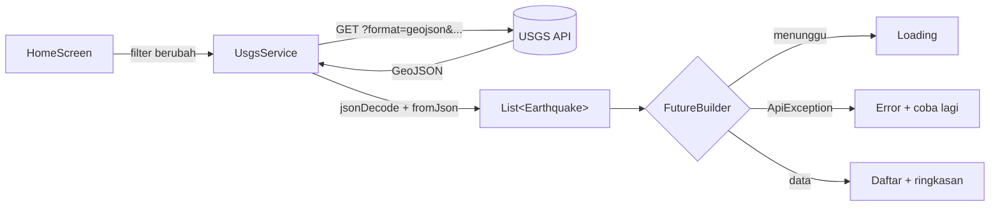

<h1 align="center">Earthquake Tracker</h1>

<p align="center">
  Daftar gempa terbaru dari seluruh dunia, bisa disaring per periode, kekuatan, dan wilayah Indonesia.
</p>

<p align="center">
  
  
  
</p>

<p align="center">
  
  &nbsp;
  
  &nbsp;
  
</p>

## Tentang aplikasi

Earthquake Tracker mengambil data kejadian gempa dari [USGS Earthquake Catalog API](https://earthquake.usgs.gov/fdsnws/event/1/), mengubah respons GeoJSON-nya menjadi objek Dart, lalu menampilkannya sebagai daftar yang mudah dipindai: magnitudo di dalam lingkaran berwarna, lokasi, waktu relatif, dan kedalaman. Ketuk satu gempa untuk melihat detailnya.

Proyek ini dibuat untuk UTS Pemrograman Mobile dan sengaja fokus pada tiga hal: request HTTP, konversi JSON ke model, dan penanganan loading, sukses, serta error dengan `FutureBuilder`.

## Fitur

| | |
|---|---|
| **Daftar gempa** | Magnitudo, lokasi, waktu, kedalaman. Warna mengikuti kekuatan, dari hijau (di bawah M2) sampai merah tua (M7 ke atas). Ikon gelombang muncul jika USGS menandai potensi tsunami. |
| **Ringkasan** | Jumlah gempa, magnitudo terbesar, dan rata-rata dari data yang sedang tampil. |
| **Filter** | Periode (1 jam, 24 jam, 7 hari, 30 hari), magnitudo minimum (semua, 2.5, 4.5, 6), dan wilayah Indonesia. Filter dikirim ke API sebagai parameter query. |
| **Cari dan urutkan** | Cari berdasarkan nama lokasi; urutkan berdasarkan waktu, magnitudo, atau kedalaman. Diproses di sisi aplikasi. |
| **Detail** | Koordinat, tipe magnitudo, status tsunami, jumlah laporan dirasakan, level PAGER, signifikansi, dan URL halaman USGS. |
| **Status data** | Indikator loading, pesan error dengan tombol coba lagi, tampilan data kosong, dan tarik ke bawah untuk memuat ulang. |

## Cara kerja



Setiap perubahan filter membuat `Future` baru, dan `FutureBuilder` membangun ulang tampilan sesuai statusnya. Error jaringan, timeout, status HTTP selain 200/204, dan JSON yang tidak valid dibungkus menjadi `ApiException` dengan pesan berbahasa Indonesia.

## Teknologi

| Package | Dipakai untuk |
|---|---|
| Flutter, Dart | Framework dan bahasa (Material 3) |
| [`http`](https://pub.dev/packages/http) | Request ke API USGS |
| [`intl`](https://pub.dev/packages/intl) | Format tanggal bahasa Indonesia |
| `flutter_test`, `http/testing` | Unit test dengan `MockClient`, tanpa jaringan |

## Menjalankan

Butuh Flutter SDK 3.22 atau lebih baru, serta emulator atau perangkat dengan koneksi internet.

```bash
git clone https://github.com/<username>/earthquake_tracker.git
cd earthquake_tracker

# hanya jika folder android/ dan ios/ belum ada
flutter create --project-name earthquake_tracker .

flutter pub get
flutter run
```

Menjalankan unit test:

```bash
flutter test
```

> **Catatan performa.** Mode debug lambat, terutama di emulator. Untuk menilai kelancaran, pakai `flutter run --profile` atau perangkat asli.
> **Build rilis Android** memerlukan izin `android.permission.INTERNET` di `AndroidManifest.xml`.

<details>
<summary>Struktur folder</summary>

```
lib/
  main.dart
  models/earthquake.dart        model dan fromJson
  services/usgs_service.dart    request ke API dan penanganan error
  screens/home_screen.dart      daftar gempa dan FutureBuilder
  screens/detail_screen.dart
  widgets/                      earthquake_tile, summary_card
  utils/magnitude_utils.dart    kategori magnitudo, waktu relatif
test/earthquake_test.dart
```

</details>

## Batasan

- Maksimal 300 gempa per permintaan.
- Filter wilayah Indonesia memakai kotak koordinat (lintang -11 sampai 6, bujur 95 sampai 141), bukan batas wilayah sebenarnya, jadi gempa di sekitar tepi kotak bisa terlewat atau ikut terbawa.
- Tidak ada penyimpanan lokal; aplikasi butuh internet setiap kali memuat data.
- Jika tidak ada gempa yang cocok, USGS membalas status 204. Aplikasi menampilkannya sebagai data kosong, bukan error.

## Sumber data

U.S. Geological Survey, [Earthquake Catalog API](https://earthquake.usgs.gov/fdsnws/event/1/).

## Pembuat

[Nama Lengkap] · [NIM] · [Program Studi], [Universitas]